<picture>
  <source media="(prefers-color-scheme: dark)" srcset="./assets/header-dark.svg">
  
</picture>

<p align="center">
  <a href="https://www.linkedin.com/in/huy-nguyen-quang-7571b7260"></a>
  <a href="mailto:huyjack2306@gmail.com"></a>
  
  
</p>

## 👋 About me

I am a **Tech Lead and Full-stack Engineer** with about **6 years** of experience. I lead teams that ship **AI products to production**.

- 🚀 Right now I lead the team behind **[Sphere](https://sphere.123rf.ai)** at **123RF (Inmagine Group, Malaysia)**, working remotely from Da Nang.
- 🌏 I have built web platforms for clients in the **US, South Korea, India and Malaysia**: generative AI, EV charging (OCPP / OCPI), contact center (CCaaS), data analytics, government portals and LMS.
- 👥 I have led front-end and full-stack teams of **up to 8 engineers**: architecture, code review, mentoring, and demos to C-level clients.
- 🤖 I use **AI-assisted engineering** every day. I brought Claude Code into my team's workflow and built agent tooling for QA, code review and releases.

## 🛠️ What I am building

<table>
  <tr>
    <td width="50%" valign="top">
      <h3>✨ Sphere</h3>
      <p>An enterprise AI platform. You give it one brand brief, and it creates a full, on-brand social media campaign.</p>
      <p><b>My role:</b> Tech Lead. I own the front-end architecture and code review, and I am the top contributor (about a third of all commits).</p>
      <p>
        
        
        
        
        
        
      </p>
      <a href="https://sphere.123rf.ai"><b>sphere.123rf.ai →</b></a>
    </td>
    <td width="50%" valign="top">
      <h3>🎨 html-design <sub><i>open source</i></sub></h3>
      <p>A Claude Code plugin. It copies screens of your running web app into HTML design files. Claude edits them when you ask, and a local viewer shows every change live.</p>
      <p><b>Your app's code is never changed.</b> Light and dark mode, 3 screen widths, and motion links between states.</p>
      <p>
        
        
        
        
      </p>
      <a href="https://github.com/huy-jack/html-design"><b>huy-jack/html-design →</b></a>
    </td>
  </tr>
</table>

## 🤖 AI-assisted engineering

| | What I did |
|---|---|
| 🧭 **Team adoption** | Brought Claude Code into daily team work, with prompting standards, agent guardrails and review rules. |
| 🧰 **Custom agent skills** | Built a set of Claude Code skills for real team work: QA test plans and regression runs, code review, PR writing, Jira and release tasks. |
| 🧠 **Engineering memory** | Designed a memory system that keeps engineering context between sessions, so the team repeats less work. |
| 🔍 **Multi-agent review** | Ran parallel review agents on several branches at once, with a second pass that checks each finding before merge. |

## 🧰 Tech stack

<p align="center">
  <br>
  
</p>

## 🗺️ Journey

```text
2025 ─┬─ 123RF (Inmagine Group) ··· Tech Lead, Sphere (enterprise AI platform)
      │
2025 ─┼─ Rikkeisoft ··············· Team Lead: AI video agent, EV charging platform (OCPP/OCPI)
      │
2023 ─┼─ Rikkeisoft ··············· Team Lead: data and analytics (team of 8), CCaaS platform
      │                              🏆 Rising Star Award 2024
2022 ─┼─ Datahouse (Hawaii, US) ··· Full-stack: government portals, Angular 4 → 14 migration
      │
2021 ─┴─ The English Lab ·········· First website: built it, deployed it, did its SEO
```

## 🏆 Recognition

- 🌟 **Rising Star Award 2024**: the most outstanding contributor of the year, Rikkeisoft DG1 Division.
- 🤝 **Recognition of Contribution 2024**: from the Rikkeisoft CEO and RKTech COO.
- 🎓 **Master's Scholarship 2024**: University of Oulu, Finland (Software Engineering).
- 🎓 **B.Sc. Computer Science**: Troy University, GPA **3.87 / 4.0**.

<p align="center">
  
</p>

<p align="center"><i>Open to remote roles in Singapore, Malaysia and Thailand. Let's talk on <a href="https://www.linkedin.com/in/huy-nguyen-quang-7571b7260">LinkedIn</a>.</i></p>
